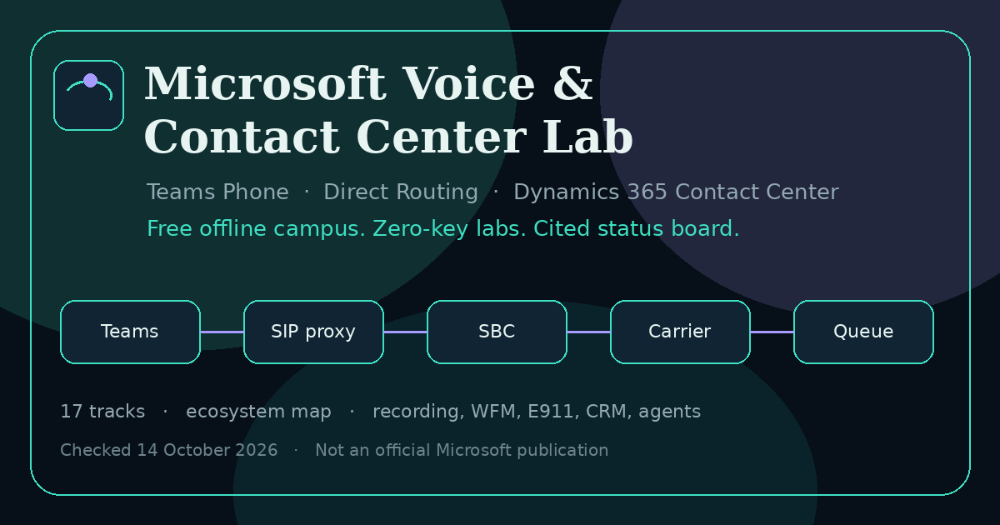
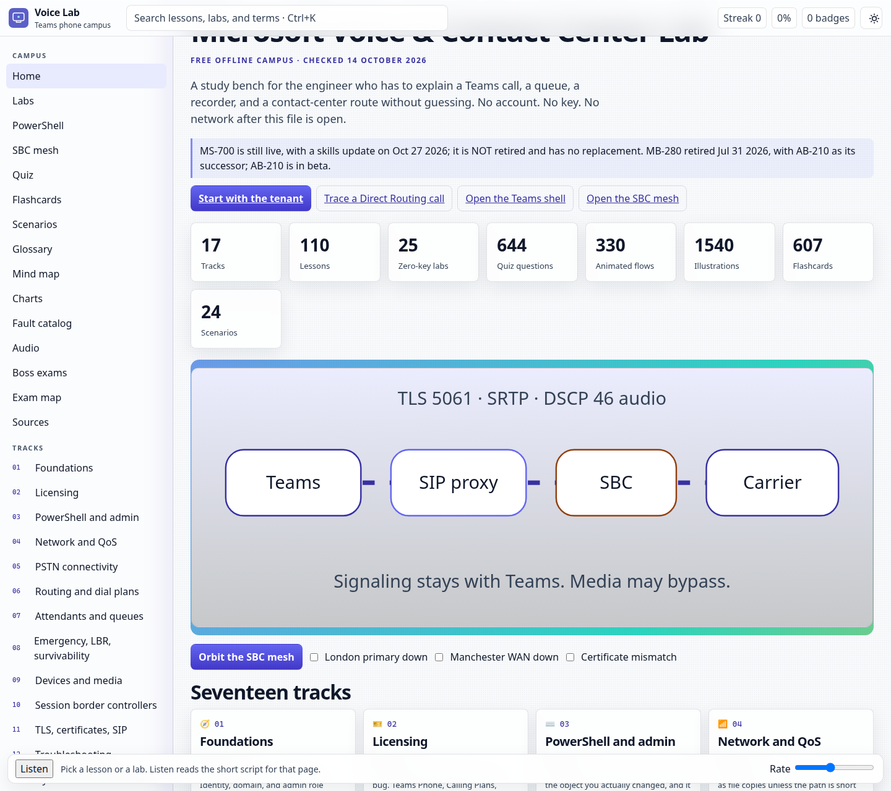
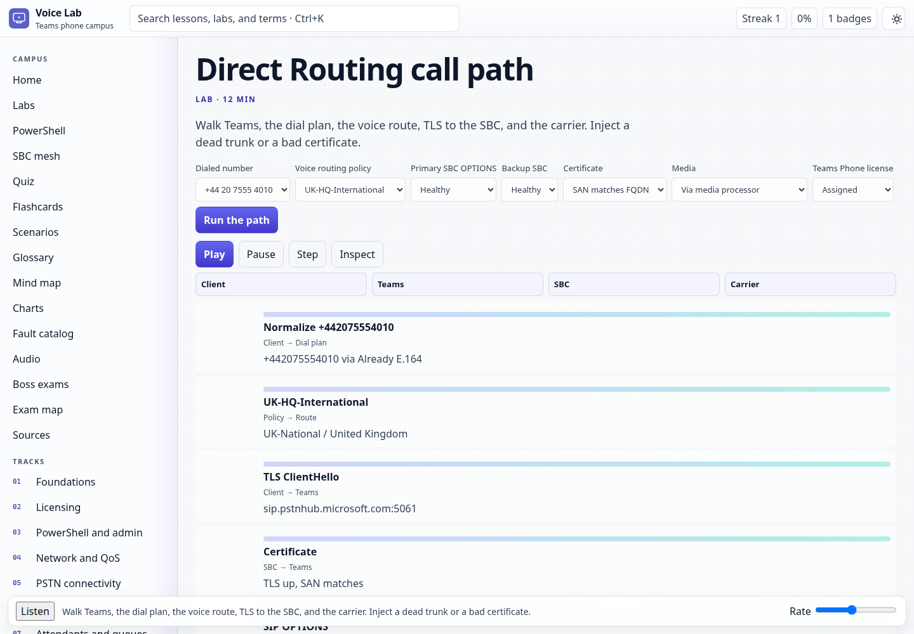
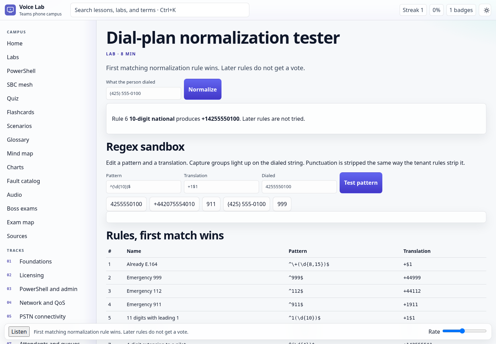
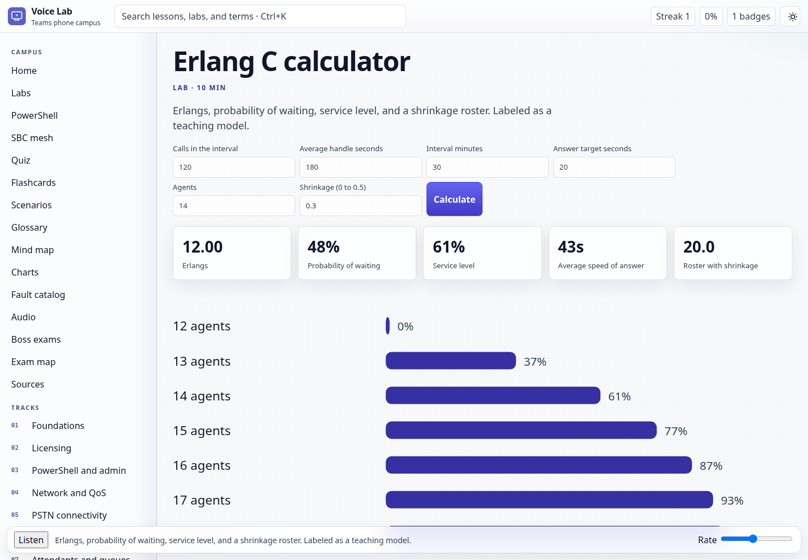
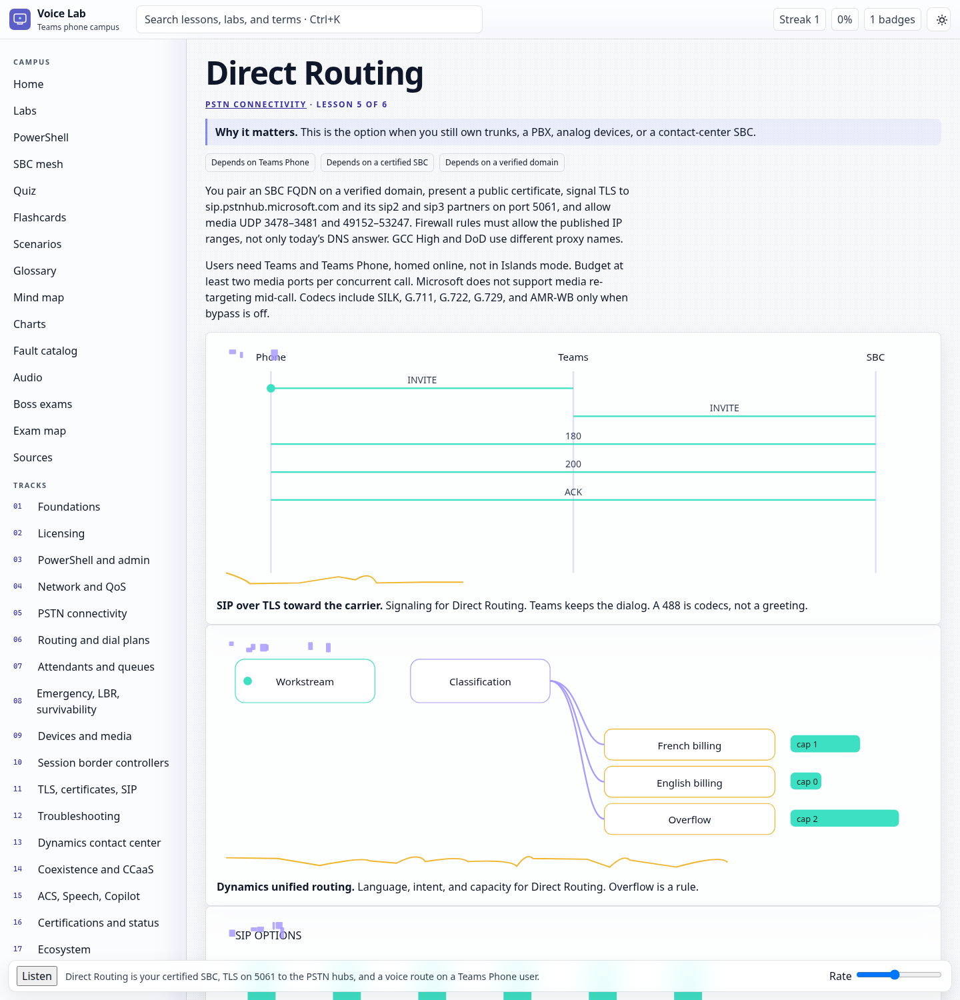
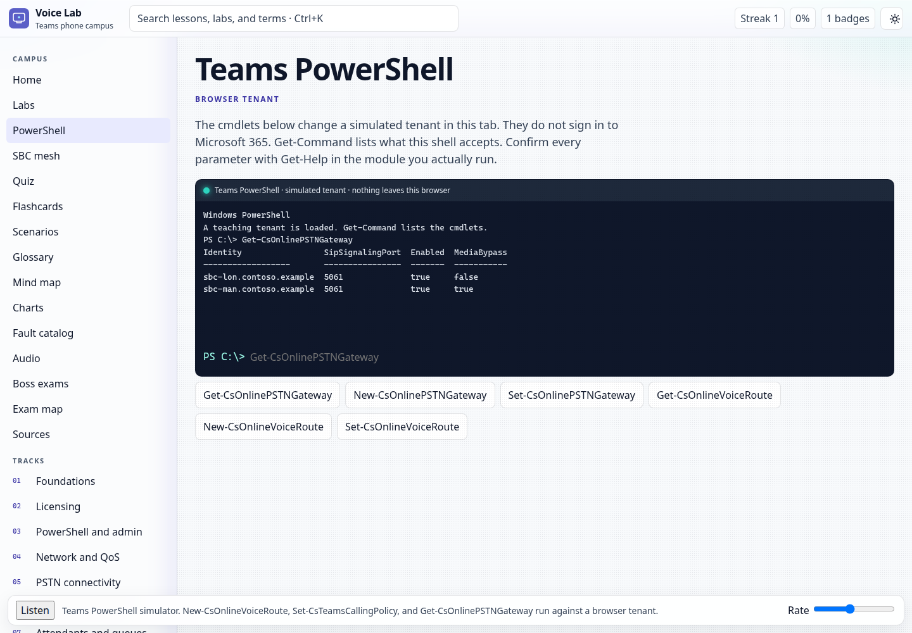
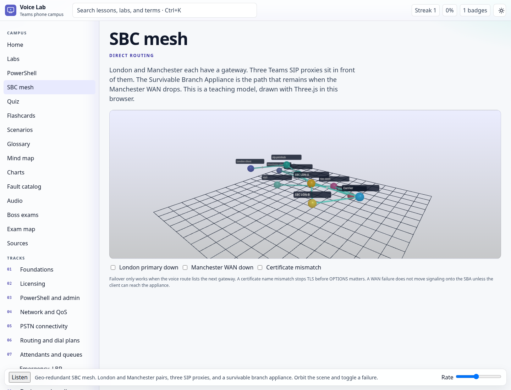
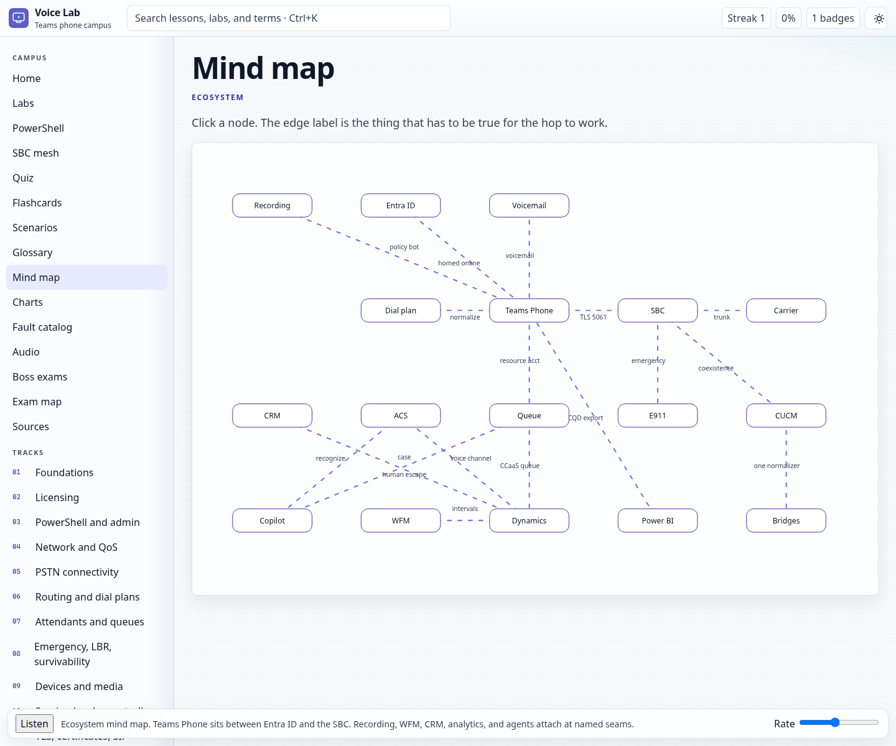

# Microsoft Voice & Contact Center Lab



A free, offline campus for a voice engineer preparing for Teams Phone and Microsoft contact-center work. The shell is a small Fluent page. Lessons, quiz, and figures load per track. No account, no API key, and no CDN. After the first online visit, a service worker keeps the campus available with the network off.

**Description.** Free offline campus for Teams voice and Microsoft contact-center study: a PowerShell console, a Direct Routing ladder, a 3D SBC mesh, labs, a fault catalog, and cited notes.

**Topics.** `microsoft-teams` `teams-phone` `direct-routing` `contact-center` `dynamics-365` `microsoft-365` `voice` `offline` `education` `study-guide`

Checked **14 October 2026**. This is not a Microsoft, Cisco, AudioCodes, Ribbon, Oracle, Genesys, or Amazon publication. When a vendor page and this file disagree, the vendor page wins. Certification seats move. Read the exam page again before you book.

## Open it

GitHub Pages serves the `campus` folder. Locally:

```bash
python3 -m http.server 8741
```

Then open [http://127.0.0.1:8741/campus/](http://127.0.0.1:8741/campus/). Search is Ctrl+K or `/`. `[` and `]` move between lessons in a track. Theme cycles light mica, dark acrylic, and high contrast. Listen waits for a voice already installed in the browser and does not upload anything. Partial hashes such as `#/track/` and `#/lesson/` redirect to a real track or home.

A zip of the campus folder is in `releases/microsoft-voice-contact-center-lab.zip`. Unzip it and serve that folder with the same Python command. Fetching the track files needs HTTP, which is also how GitHub Pages hosts it.

Progress, theme, lab runs, and exam self-ratings stay in `localStorage` under `mvcc-lab-v1`. The file does not ask for a name.

## What is inside

| | |
|---|---|
| Tracks | 17, each with why it matters and what it depends on |
| Lessons | 110, each with three animated flows, at least three diagrams, and a Try it link |
| Illustrations | 1,540 distinct inline SVGs |
| Animated flows | 330 |
| Charts | 22, including licensing, CQD, Erlang C, and the certification and feature timelines |
| Labs | 25, all runnable with no key |
| Quiz | 644 questions, each with an explanation and a source |
| Boss exams | 6: MS-700, AB-250, MB-280, AB-210, AZ-900, SC-900. Each one opens as an incident with a synthetic SBC or service log, then the question bank |
| Flashcards | 607 |
| Scenarios | 24 |
| Glossary | 347 terms, with a config note and a fault |
| Fault catalog | 36 rows: symptom, cause, fix, check, source |
| Audio | 32 offline clips beside the HTML (DTMF, call progress, attendant samples, short intros) |
| Sources | 52, dated 14 October 2026 |

Rebuild the file from the sources, then check the counts:

```bash
python3 tools/build_campus.py
python3 tools/make_og.py
python3 scripts/verify_campus.py
```

## Studios

- **Teams PowerShell.** A simulated tenant for `Get-CsOnlinePSTNGateway`, `New-CsOnlineVoiceRoute`, `Set-CsTeamsCallingPolicy`, and the Grant cmdlets that actually assign a policy. Nothing signs in to Microsoft 365.
- **Direct Routing ladder.** Play, pause, step, and inspect TLS, OPTIONS, INVITE, and the media-bypass or media-processor path. Lesson flows use the same controls.
- **E.164 sandbox.** Edit a normalization pattern and see the capture groups on the dialed string.
- **E911 discovery.** A client BSSID or subnet is matched to a teaching LIS record, a civic address, and the Direct Routing emergency hop.
- **SBC mesh.** Three.js, vendored in `campus/vendor`, draws the London and Manchester gateway pair, the three SIP proxies, and the Survivable Branch Appliance. Orbit the scene and toggle a dead primary, a WAN cut, or a certificate mismatch. Reduced motion keeps a still frame.

The skin uses campus-core tokens (`--cc-bg`, `--cc-surface`, `--cc-accent-1` through `--cc-accent-4`) with Aptos / Segoe UI fallbacks, acrylic panels, and icons drawn in the page.

## Page weight

Checked 14 October 2026 against a local server.

| | Before | After |
|---|---|---|
| First load | 4.91 MB in one HTML file | 442 KB: HTML 5 KB, CSS 23 KB, app script 138 KB, manifest 277 KB |
| Three.js | none | 671 KB, loaded only when the mesh opens |
| DOM | one lesson stays on screen | Home 303 nodes, Direct Routing lesson 567 nodes |
| Lighthouse mobile | not scored on the monolith | Performance 92, accessibility 100 |

## Study order

1. Foundations, licensing, PowerShell, and the network.
2. PSTN connectivity, dial plans, voice routing, attendants, and queues.
3. Emergency calling, devices, SBCs, TLS, and troubleshooting.
4. Dynamics 365 Contact Center, coexistence, ACS, Speech, and Copilot Studio.
5. The exam status board, then the ecosystem track.

If you have one hour: the tenant boundary, Direct Routing, the normalization tester, the voice-routing matcher, and the ecosystem mind map.

## Ecosystem track

Track 17 is the systems around the call, not another Teams policy.

- Glossary, with config and the fault you see when the term is wrong.
- Mind map of Entra ID, Teams Phone, the SBC, the carrier, recording, WFM, emergency location, Dynamics, ACS, Copilot Studio, CQD and Power BI, and CRM.
- Sister technologies: workforce management, compliance recording and quality management (including Teams compliance recording), E911, analytics and Power BI, CRM and screen pop, and AI agents with a human escape.
- Integration maps, cross-platform bridges (CUCM, Webex, UCCE, Genesys, Amazon Connect), and future-integration hooks that use products that exist today.

Labs on that track: Erlang C (labeled as a teaching model), the compliance-recording builder, the integration map, and the hook planner.

## Labs

Direct Routing call path, voice-routing matcher, dial-plan tester, auto attendant and queue builder, SBC checklist, TLS handshake, CQD fault cases, licensing picker, CUCM-to-Teams translator, unified-routing designer, ACS call automation, Erlang C, exam readiness, QoS marker, emergency location, SIP OPTIONS, media bypass, coexistence, usage builder, codec bandwidth, IVR escape, Survivable Branch Appliance, compliance recording, integration map, and future hooks.

Numbers in the labs are samples (`555`, `contoso.example`). Do not place a real emergency call to test a lab.

## Exams named on the status board

MS-700 is still live, with a skills update on Oct 27 2026; it is NOT retired and has no replacement. MB-280 retired Jul 31 2026, with AB-210 as its successor; AB-210 is in beta.

AB-250 is the Dynamics 365 Contact Center exam; confirm the live seat. AZ-900 and SC-900 are live (SC-900 English update 21 October 2026). MS-900 and AI-900 are retired. Renewal is not retirement. AB-210 is not the contact-center exam and it is not a replacement for MS-700.

## Sister projects

- [UC Lab](https://github.com/cipher0x9/uc-lab-free-university-mesmerizing)
- [AI Lab](https://github.com/cipher0x9/ai-lab-free-university-mesmerizing)
- Design reference: [Gemini Gems gallery](https://cipher0x9.github.io/gemini-gems-free-gallery/site/)

## License

MIT. Copyright (c) 2026 Microsoft Voice & Contact Center Lab. See `LICENSE`.

## Screenshots

Home, with the call path and the seventeen tracks:



Direct Routing call path, after a run:



Dial-plan normalization, first match wins:



Erlang C, labeled as a teaching model:



A lesson, with the flow and the chart:



Teams PowerShell, after `Get-CsOnlinePSTNGateway`:



The geo-redundant SBC mesh:



Ecosystem mind map:


